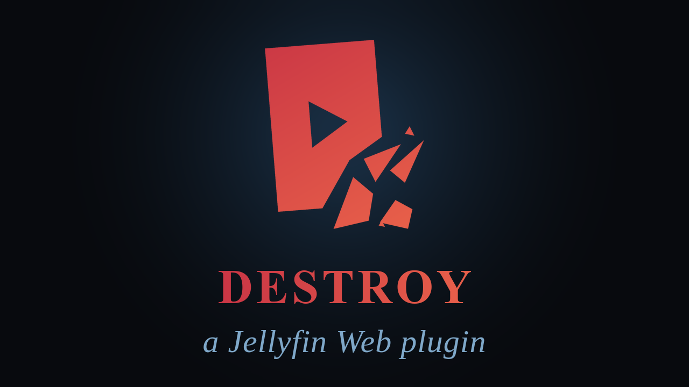

https://github.com/user-attachments/assets/81be34ce-cc15-41a1-8ad3-8bccde0c5a00

[Jellyfin Projects](https://linktr.ee/JellyfinProjects) | [Kodi Projects](https://linktr.ee/KodiProjects)

---



*Not affiliated with or endorsed by Jellyfin.*

---

**Alpha.** Destroy is an early public version. It works, but expect rough edges, and settings or behaviour may still change. Feedback and bug reports are very welcome.

---

Destroy Any Website by Hugo Duprez is a small game that turns any web page into a level: a little hero runs, jumps and shoots across the page until nothing is left of it. I wanted exactly that for Jellyfin. Not on a random website, but on my own library, with heroes from my own films and lines from my own series.

So I built Destroy. It plays on the Jellyfin page you are looking at, knows which film, series or actor is on screen, and talks about it while it tears the page apart.

I have developed many Jellyfin Web script mods over the years, but besides this one, only three other true plugins: [ArtworkPlus](https://github.com/chrissix666/Jellyfin-ArtworkPlus), which shows the artwork Jellyfin leaves unused, [Cinema Project](https://github.com/chrissix666/Jellyfin-Cinema-Project), a virtual cinema environment based on three.js that gives your movies an ambient feel, and [VideoOSD Tweaks and Candy](https://github.com/chrissix666/Jellyfin-VideoOSD-Tweaks-Candy), which puts you in full control of the Jellyfin video player OSD.

---

# Jellyfin Destroy

- [What This Is](#what-this-is)
- [What This Is Not](#what-this-is-not)
- [Under the Hood](#under-the-hood)
  - [Architecture](#architecture)
- [The Game](#the-game)
  - [Heroes](#heroes)
  - [Weapons](#weapons)
  - [Destruction](#destruction)
  - [Controls](#controls)
- [The Lines](#the-lines)
  - [Where the Lines Appear](#where-the-lines-appear)
  - [How a Line Is Chosen](#how-a-line-is-chosen)
  - [The Numbers](#the-numbers)
- [Settings](#settings)
- [Requirements](#requirements)
- [Installation](#installation)
- [Developed For & Tested On](#developed-for--tested-on)
- [Credits](#credits)
- [License](#license)

---

**Destroy turns the Jellyfin page you are looking at into a level: run, jump and shoot through posters, cards, buttons and text until nothing is left. A pixel hero from the film on screen does the work, and thousands of lines from the films, series and actors on the page pop up while they fall apart.**

---

## What This Is

A Jellyfin Web plugin with a browser game inside. Press the Destroy button in the header, or the keyboard shortcut, and the page you are on becomes the level.

Every poster shatters into its own picture. Cards hang on one nail and swing before they fall, text breaks word by word, the backdrop behind the page takes bullet holes and scorch marks. The hero fits the page: on a Terminator page you play a Terminator, on a Star Trek page a captain.

And the page talks back. Destroy a person card and that actor says one of their lines from the film you are on. Destroy a film card and the film answers with a quote. Destroy the search button and it has a joke about that too.

---

## What This Is Not

Destroy is not a skin, not a theme, and it does not change anything in Jellyfin.

It plays on a copy of the page. Your library, your settings and the page itself stay exactly as they were. Close the game and you are back where you started, on the same page, at the same scroll position.

It does not download anything for your library and adds nothing to it.

---

## Under the Hood

### Architecture

Destroy is a native Jellyfin plugin with two parts.

The server part is written in **C#**. It adds one script tag to Jellyfin Web's `index.html`, through the File Transformation plugin when it is installed, otherwise written into `index.html` directly (and removed again on uninstall). It serves the game script, the hero sprites and the quote blocks itself, nothing is loaded from outside, and it stores the admin settings in the Jellyfin backend.

The game part is **JavaScript**. When the game starts, the live, rendered page is copied into a same-origin frame: the page's styles are read from the browser and written into the copy, scripts are left out, pictures that have not loaded yet are filled in. The game runs on that copy inside a shadow-DOM overlay, so nothing of it can leak into Jellyfin's own page. One script serves both Jellyfin lines, 10.10.7 and 12.0+.

The game itself is a port of Destroy Any Website, with Jellyfin's pages, heroes, weapons, effects and lines built on top.

---

## The Game

### Heroes

228 pixel heroes, each drawn by hand and each with a signature weapon of their own. Every hero belongs to the films or series of its character: open a film's page and its hero starts. Films with several fitting heroes give you all of them.

- **Party:** up to six heroes at a time, switched with a key
- **Roster:** all heroes as Jellyfin cards, pick any of them
- **Rescue:** destroy a film poster, and its hero is freed and joins in
- **Automatic or fixed:** the admin page, or each user in the game's menu, can start with a fixed hero instead

---

### Weapons

Seven standard weapons: pistol, SMG, shotgun, RPG, railgun, flamethrower and missiles. Plus each hero's signature weapon, from a minigun to thrown knives, a whip, a shield or a lightsaber, and a grenade for everyone.

Every weapon leaves its own marks: bullet holes by calibre, cuts, dents, scorch marks and burn-outs.

---

### Destruction

Nothing breaks the same way twice. A poster can shatter into its own picture, lose a piece and keep the rest, hang on one nail and swing before it falls, tip over, crumble, split along the cut or burn out. Fire spreads from card to card, explosions throw sparks and smoke, debris piles up and can be kicked.

Behind the page sits the page's own backdrop. It is never destroyed, but it takes holes, cracks and scorch marks.

---

### Controls

Keyboard and mouse, or a controller. Destroy is fully playable with a controller alone.

| Action | Keyboard / Mouse | Controller |
|---|---|---|
| Run | A / D | Left stick |
| Aim | Mouse | Right stick |
| Shoot | Left mouse button | RT |
| Grenade | Right mouse button | LT |
| Jump, again to flip | Space | A |
| Jetpack | Hold Space | Hold A |
| Drop through | S | D-pad down |
| Switch weapon | 1 to 7 | LB / RB |
| Special | F | R3 |
| Next hero | H | Y, D-pad left / right |
| All heroes | C | D-pad up |
| Autopilot | B | |
| Sound on / off | M | |
| Score | Tab | View |
| Pause | Esc | Menu |

Start: the Destroy button in the header, the shortcut (Alt+Shift+D by default), or View + Menu on a controller.

---

## The Lines

This is the part of Destroy that took the longest. The game knows what is on the page, and it says something about it: a quote from the film, a line of the actor you just shot, a joke about the button you just blew up. **925,870 lines from 8,610 films and series** ship with the plugin, plus a few thousand of Destroy's own.

### Where the Lines Appear

- **Person cards** (cast and crew on a detail page, people pages): the actor says one of their own lines from the film or series of that page
- **Film and series cards:** on a person's page, that person's line from this film; elsewhere, now and then, a quote from the film or series itself
- **The detail page itself** (poster, title, logo, backdrop): a quote of that title, or a line about it
- **Seasons and episodes:** lines from that very episode or season first, then from the whole series
- **The hero:** shortly after the start, and again now and then while the page falls apart, the hero says one of their own lines
- **Jellyfin's own controls:** search, cast, SyncPlay, user menu, play buttons, hearts, check marks and many more each have their own jokes
- **Everything else:** lines built from the facts Jellyfin has about the title or person, like its franchise, its sequels, its genre, its rating, its runtime, the actor's age, roles and other films

---

### How a Line Is Chosen

Films are matched by their TMDb id, series by their TVDB id, the same ids Jellyfin uses. Seasons and episodes go through their series, and then by season and episode number.

1. A person's own line from the medium on screen
2. A line of a co-star from one of the hero's own films or series
3. A line of the film or series itself, episode before season before series
4. Destroy's own lines, built from Jellyfin's facts about the title or person

Well-known short lines come up more often than long dialogue, and a line said in the last 40 is almost never said again. People who have died are never mocked, they get their quote instead.

The lines can be switched off on the admin page, and by each user in the game's menu.

---

### The Numbers

Counted from the data that ships with this release.

**Quotes**

- 8,610 titles with lines: 6,844 films and 1,766 series
- 925,870 lines: 297,009 from films, 628,861 from series
- 778,404 of them are tied to the person who says them, 33,151 different people
- 304,102 series lines are tied to their season or episode
- 33,360 lines of the heroes' own characters, from 400 titles: 208 of the 228 heroes have lines of their own

**Destroy's own lines**

- 2,517 line templates in 730 rules, built from Jellyfin's facts about titles and people
- 477 lines for 161 actors, in their own style
- 518 jokes for 140 parts of Jellyfin's pages and cards
- 1,037 people who are never mocked

---

## Settings

Under **Dashboard → Plugins → Destroy**. They apply to every user.

- **Enable Destroy:** the game as a whole
- **Show the Destroy button** in the header
- **Keyboard shortcut:** on or off, and the key combination
- **Enable controller**, and **View + Menu starts the game**
- **Start muted**
- **Start hero:** Automatic (the hero of the film or series on screen) or a fixed one, with a preview
- **Effect quality:** Automatic, High, Medium, Low. Automatic lowers sparks, smoke and debris on slower computers.
- **Show one-liners:** the lines described above
- **Allow personal settings:** lets each user pick their own shortcut, hero, effect quality and one-liners for their browser in the game's menu
- **Record diagnostics:** off by default. Writes what happens in the game, problems and performance, into the folder `destroy-diagnostics` in the server's data folder. Only useful for a bug report.
- **Backup / restore via code:** all settings as one code

---

## Requirements

Destroy runs in Jellyfin Web in a desktop browser, with a mouse and keyboard or a controller.

It also runs in the apps that load the server's own Jellyfin Web page: Jellyfin Desktop, Jellyfin for Xbox (controller only), Jellium, Noktus and MediaFlick. These are not tested.

It does **not** run in the native Jellyfin apps for Android, iOS, Android TV, webOS or other TV platforms, since none of those run the server's Jellyfin Web page. In Jellyfin's TV layout the button does not appear.

---

## Installation

1. In Jellyfin, go to **Dashboard → Plugins → Repositories → Add Repository** and add:

```
https://raw.githubusercontent.com/chrissix666/Jellyfin-Destroy/main/manifest.json
```

2. Go to **Catalog**, find **Destroy**, install it, and restart the Jellyfin server. Jellyfin picks the build that matches your server on its own: 1.x for 10.10.7, 2.x for 12.0+.
3. Reload Jellyfin Web. The Destroy button appears in the header.

The [File Transformation](https://github.com/IAmParadox27/jellyfin-plugin-file-transformation) plugin is recommended. Without it, Destroy writes its script tag into Jellyfin Web's `index.html` itself. Where Jellyfin's web folder is read-only, as in many Docker setups, that is not possible, and Destroy needs File Transformation to start.

---

## Developed For & Tested On

- Designed and written for Jellyfin Web 10.10.7 and 12.0+
- Google Chrome
- Windows 11

Other versions may work but are not tested and could lead to unexpected behavior.

---

## Credits

- The game is a port of [destroy-any-website](https://github.com/ychisbest/destroy-any-website) by ychisbest (MIT), a remake of Hugo Duprez's game Destroy Any Website
- Quotes: [English Wikiquote](https://en.wikiquote.org), licensed under [CC BY-SA 4.0](https://creativecommons.org/licenses/by-sa/4.0/). The Wikiquote page of every title is listed in `quote-sources.json` in the release ZIP.
- Film, series and cast data: [TMDb](https://www.themoviedb.org) and [Wikidata](https://www.wikidata.org). This product uses the TMDB API but is not endorsed or certified by TMDB.
- Film and series titles, characters and quotes belong to their respective owners

---

## License

MIT License

The code is MIT licensed. The quote data (`quotes.zip` in the release ZIP) is adapted from English Wikiquote and licensed under [CC BY-SA 4.0](https://creativecommons.org/licenses/by-sa/4.0/).

Forking and further development strongly encouraged.
Feedback and bug reports welcome, feel free to open an issue.

---
